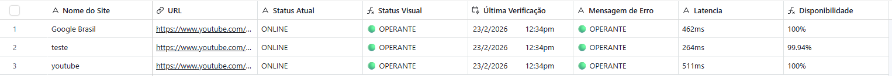
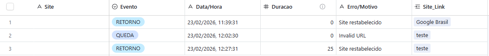
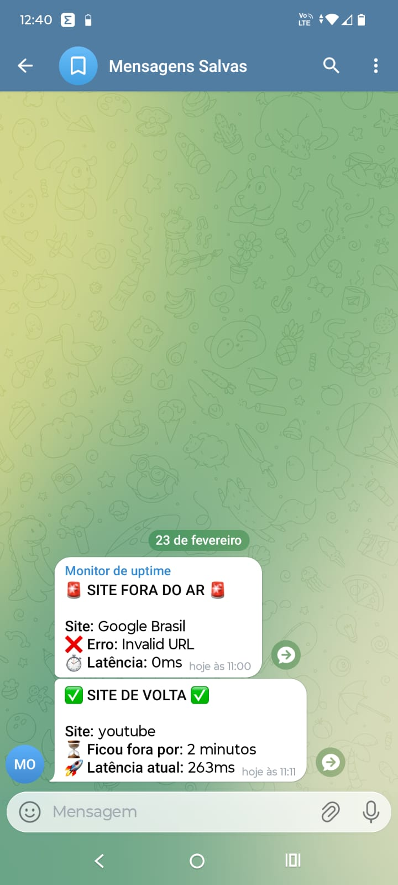

# 📡 Monitor de Uptime (Node.js + Airtable + n8n)

Monitor de disponibilidade de sites no estilo do UptimeRobot. Um robô em **Node.js** checa cada site a cada minuto, guarda status, latência e incidentes no **Airtable** (que também calcula o SLA) e avisa pelo **Telegram**, via webhook do **n8n**, quando um site cai e quando volta.

## 📸 Demonstração

### 1. Painel de controle (Airtable)
Status em tempo real, latência e o cálculo automático de disponibilidade (SLA).


### 2. Histórico de incidentes
Cada queda e cada retorno ficam registrados e vinculados ao site pelo Record ID.


### 3. Alertas no Telegram
O n8n recebe o evento e manda o erro detectado e, no retorno, o tempo total fora do ar.


## 🛠️ Tecnologias

- **Node.js + Axios**: checagem HTTP, medição de latência e chamadas às APIs
- **Airtable**: banco relacional (sites + histórico) e fórmula de SLA
- **n8n**: recebe o webhook e orquestra os alertas
- **Telegram Bot API**: canal de alertas

## ✨ Como funciona

```
a cada 60s ─► bot/uptime.js ─► GET em cada URL cadastrada no Airtable
                   │
                   ├─ site OK ............ atualiza status e latência
                   ├─ site caiu agora .... registra QUEDA + webhook DOWN ─► n8n ─► Telegram
                   └─ site voltou ........ registra RETORNO com minutos fora + webhook UP
```

- Checagem de status HTTP e latência a cada minuto (timeout de 15 s)
- Só notifica na **mudança de estado**, sem repetir alerta enquanto o site continua fora
- Logs de incidentes vinculados ao site (campo de link do Airtable)
- Uptime % calculado sobre um mês de 30 dias (43.200 minutos)

## 🏗️ Estrutura da base no Airtable

1. **Sites monitorados** (tabela principal)
   - `Nome do Site` (texto), `URL` (URL)
   - `Status Atual` (seleção única: ONLINE/OFFLINE)
   - `Mensagem de Erro`, `Latencia` (texto)
   - `Duracao` (rollup: soma da duração dos incidentes)
   - `Uptime %` (fórmula abaixo)
2. **Historico_Incidentes**
   - `Site_Link` (link para a tabela principal)
   - `Evento` (QUEDA/RETORNO), `Duracao` (número, minutos), `Data/Hora`, `Erro/Motivo`

Fórmula do SLA:

```
IF({Duracao} > 0,
  ROUND((1 - ({Duracao} / 43200)) * 100, 2) & "%",
  "100%"
)
```

## 🚀 Como rodar

```bash
git clone https://github.com/MChaves-21/AUTOMACAO-N8N.git
cd "AUTOMACAO-N8N/Monitor uptime"
npm install
```

Crie o arquivo `bot/.env`:

```env
AIRTABLE_PAT=seu_token
BASE_ID=id_da_base
TABLE_ID=id_da_tabela_principal
N8N_WEBHOOK_URL=url_do_webhook_no_n8n
```

Importe o fluxo `json/uptime-monitor-flow.json` no n8n (**Workflows → Import from File**), configure a credencial do Telegram e ative o workflow. Depois:

```bash
npm start
```
