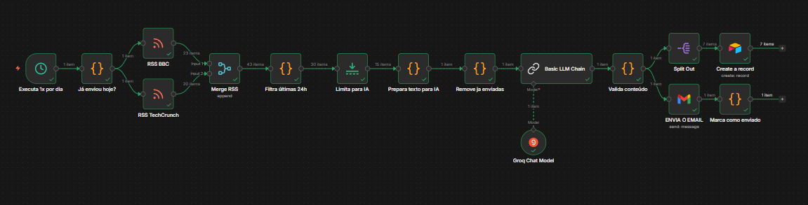

# ⚙️ Automações com n8n e IA


Automações que construí com **n8n**, versionadas como JSON: conectam APIs, processam dados com LLM e entregam o resultado por e-mail ou Telegram. É o mesmo tipo de trabalho que faço no estágio de automação de processos.

## 📂 Projetos

### 🏛️ [ATLAS: curadoria de notícias com IA](./ATLAS)
Lê feeds RSS, descarta notícias antigas e duplicadas e manda cada uma para o **Llama 3.1 (Groq)**, que resume, categoriza e define o sentimento. Tudo fica salvo no **Airtable** e as mais relevantes chegam num e-mail HTML pelo **Gmail**.



**Stack:** n8n · Groq (Llama 3.1 8B) · Airtable · Gmail API · JavaScript

### 📡 [Monitor de Uptime](./Monitor%20uptime)
Robô em **Node.js** que checa sites a cada minuto, registra quedas e retornos no **Airtable** (com cálculo de SLA) e dispara alertas no **Telegram** por meio de um webhook do n8n.

**Stack:** Node.js · Axios · Airtable · n8n · Telegram Bot API

## 🐳 Subir tudo com Docker

O `docker-compose.yml` sobe o **n8n** e o **robô de uptime** juntos:

```bash
cp "Monitor uptime/bot/.env.example" "Monitor uptime/bot/.env"   # preencha os dados do Airtable
docker compose up -d
```

O n8n fica em http://localhost:5678, com os dados salvos em um volume.

## 🛠️ Como importar um workflow

1. Baixe o `.json` do projeto.
2. No n8n: **Workflows → Import from File**.
3. Configure suas credenciais nos nós que pedirem (Groq, Airtable, Gmail, Telegram).

## 🛡️ Segurança

Os `.json` exportados **não contêm credenciais**: o n8n remove tokens e senhas na exportação. Variáveis do robô ficam em `.env`, que está no `.gitignore`.
